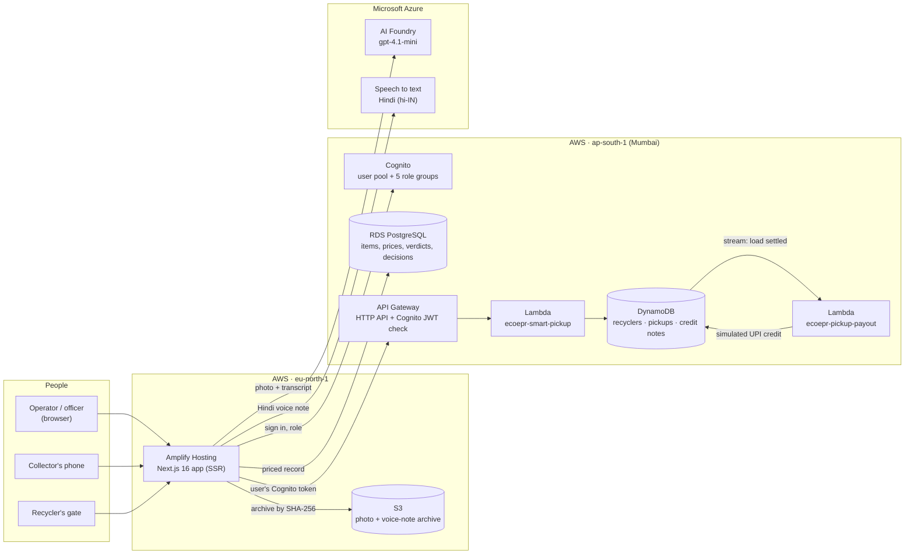

# EcoEPR — demo video script

**Version:** `main` at `9ef4852` (11 Oct 2026) · **Running time:** about 4 minutes

This file has everything needed to record the demo: the problem, how the product works, the architecture, the AWS services, and a scene-by-scene script with what to show and what to say.

---

## 1. The problem

Indian brands must prove where their electronics end up. Under Extended Producer Responsibility (EPR), the Central Pollution Control Board (CPCB) holds every brand responsible for collecting and recycling the e-waste its products become. They have no reliable way to prove that it happened.

- India generates **3.2 million tonnes** of e-waste a year.
- **Over 90%** of it moves through informal collectors, with no safety protocol and no paper trail.

Three things break between the collector's doorstep and the brand's compliance file:

| What breaks | Why it matters |
| --- | --- |
| **The collection is invisible** | Nothing is geotagged, weighed or receipted, so the tonnage never reaches a compliance file. |
| **Any photo can claim a credit** | Without a check before payout, a photo of a plastic bottle earns the same credit as a laptop motherboard. |
| **Rates rest on trust** | Ask an AI model for a scrap price and it invents a rupee figure that no auditor can reconstruct. |

## 2. The solution in one sentence

EcoEPR turns a photo or a Hindi voice note into a metal assay, a price computed on the server, and an EPR credit note. It routes the load only to CPCB-registered recyclers and pays the collector when the recycler confirms the handoff.

One item goes through four steps. Nothing is promised to the collector until step 3 clears it.

1. **Identify:** a photo or a Hindi voice note goes in; the item, brand and hazard class come out.
2. **Value:** assay the metals by mass, price them from the rate card on the server, and issue the brand's EPR credit.
3. **Gatekeep:** refuse anything that isn't e-waste before a rupee is promised.
4. **Pick up and credit:** route the load to a licensed recycler, check it at the gate with a PIN, and pay the collector.

## 3. Architecture

How a request flows:

1. **The app** is one Next.js 16 application on **AWS Amplify Hosting**. It serves the public landing page and the working screens, and every server-side step runs inside it.
2. **Sign-in** goes to **Amazon Cognito**. The session is the Cognito ID token in an httpOnly cookie, and the user's Cognito group is their role.
3. **An intake** sends the voice note to **Azure Speech** for a Hindi transcript. The photo and transcript then go to **Azure AI Foundry** (gpt-4.1-mini) in one call.
4. **The model never states a price.** It answers in closed vocabularies: an item class from a fixed list, material IDs with mass estimates, a verdict and a confidence. The server rejects any answer outside those lists and prices the materials from the **rate card**. The rupee figure is the server's arithmetic, so an auditor can re-run it line by line.
5. **Evidence:** the photo and voice note are stored in **Amazon S3** under their SHA-256 hash. They're read back only through short-lived signed URLs, never a public link.
6. **The record:** the submission, the item, its assay, the valuation, the gatekeeper verdict and any human decision go into **Amazon RDS for PostgreSQL**.
7. **Smart pickup:** the app calls an **API Gateway** HTTP API with the user's own Cognito token. A Cognito JWT check guards every route. Behind it, a **Lambda** function routes the load to a licensed recycler and issues the handoff PIN. That function's data lives in **DynamoDB**: the recycler directory, the loads and the credit notes.
8. **Payout:** when the gate settles a load, the **DynamoDB Stream** triggers a second Lambda. It sends the collector's credit (simulated UPI) exactly once per settled load.

## 4. AWS services used

| Service | What it does in EcoEPR | Region |
| --- | --- | --- |
| **AWS Amplify Hosting** | Builds and serves the Next.js app (server-side rendering on Lambda) | eu-north-1 |
| **Amazon Cognito** | Sign-up, sign-in, sessions; 5 groups = 5 roles | ap-south-1 |
| **Amazon RDS (PostgreSQL)** | The ledger: submissions, items, assays, valuations, verdicts, decisions, users, map points | ap-south-1 |
| **Amazon S3** | Private archive of every photo and voice note, keyed by SHA-256, read through signed URLs | eu-north-1 |
| **Amazon API Gateway** | HTTP API in front of the pickup service; Cognito JWT check on every route, throttling per stage | ap-south-1 |
| **AWS Lambda** | `ecoepr-smart-pickup` (routing, PINs, settlement) and `ecoepr-pickup-payout` (stream consumer) | ap-south-1 |
| **Amazon DynamoDB + Streams** | `ecoepr-recyclers`, `ecoepr-pickups`, `ecoepr-credit-notes`; the stream triggers the payout | ap-south-1 |
| **AWS IAM** | One role that can write the three tables and nothing else; a payout role that can read the stream and update pickups | — |

Outside AWS: **Azure AI Foundry** (gpt-4.1-mini) reads the photo and transcript, and **Azure Speech** transcribes Hindi. The map uses MapLibre with OpenFreeMap tiles.

Collector, load and credit data stays in India (ap-south-1). The app and the media archive run in eu-north-1, so an operator's request crosses regions to reach the pickup API. That trade-off was deliberate.

## 5. How each feature works

### Intake (photo + Hindi voice note)
- The operator photographs the item and records what the collector says in Hindi.
- Azure Speech transcribes the voice note. Silence produces no transcript rather than an invented one.
- The model reads the photo and transcript together and returns the item, brand, condition, materials and a verdict, with a confidence on every extracted field.
- The screen shows the Hindi transcript, its English translation, the extracted fields and the price.

### Valuation
- **Assay by mass:** each material line has a mass, and the item's mass is the exact sum of its lines.
- **Price on the server:** each line is priced from the rate card, then the item class's handling fee is subtracted. The collector is never shown a negative offer; a shortfall is the operator's cost.
- **EPR credit:** each item class carries a scheduled credit for the brand, with a credit note number.
- Hazardous and inert fractions are priced at zero and carry a handling note instead, because they cost money to dispose of.

### Gatekeeper (fraud prevention)
- Every upload is judged **verified**, **review** or **rejected** before anything is promised.
- A rejection names the rule it broke:
  - **R-01** not e-waste (a bunch of bananas);
  - **R-02** a duplicate submission;
  - **R-03** a working device that should go to reuse (the credit is shown, then withheld);
  - **R-04** a swollen battery.
- A verified outcome needs a photo. A voice note alone is held for review, because a spoken claim can't earn an automatic credit.
- Each photo gets exactly one submission ID, derived from its own hash, so the same photo can never be paid twice.

### Validation queue
- Items the gatekeeper holds wait for an officer, who chooses *Approve as recyclable*, *Send to reuse* or *Reject as non-e-waste*.
- Every decision is recorded with who made it and when, and can be undone from the queue.

### Evidence archive
- Every submission's photo or voice note can be looked up by its ID and opened through a signed S3 link.
- A photo is never deleted while a submission still points at it (the database enforces this).

### Hotspot map
- Geotagged intakes are filed to their district across India, and to the BMC ward inside Mumbai.
- A **hotspot** is 4 or more detections within 150 m in the last 21 days.
- Operators can dispatch a van to a hotspot from the map.

### Smart pickup and digital credit (the handoff demo)
1. On the **collector's phone**, the collector taps *Hand over e-waste*. The load (here, lead-acid batteries) is routed only to a recycler licensed for that hazardous stream. In the demo that's the GreenLoop Battery Line (RX-02), and the route skips unlicensed sites.
2. The phone shows a **4-digit PIN**. It expires after 15 minutes and locks after 5 wrong tries; the phone can then get a new one.
3. At the **recycler's gate**, staff weigh the load and type the PIN. A wrong PIN is refused with the tries left. A weight that differs from the declared mass is flagged for review.
4. The right PIN settles the load, and a **credit note** is issued (₹450.00 in the demo).
5. The DynamoDB Stream triggers the payout Lambda, and the phone turns green: **UPI payment successful**.
6. The gate shows the full audit trail: *Routed to RX-02 → Handoff PIN issued → Wrong PIN entered → PIN verified at the gate → Settled · ₹450.00 → UPI payout sent*.

### Roles and access

| Role | Meant for | Opens |
| --- | --- | --- |
| Owner | The organisation | Everything an Admin can (billing isn't built yet) |
| Admin | Team and prices | Team, Rate card, and everything an Officer can |
| Officer | Compliance decisions | Valuations, Validation queue, Recyclers, and everything an Operator can |
| Operator | Field work | New intake, Pickups, Collector handoff, Recycler gate, Handoff demo, Evidence, Collectors, Map, Dashboard |
| Viewer | A municipality or brand analyst | Dashboard and Hotspot map, read-only |

The proxy, the data layer and the navigation all enforce one access table (`lib/auth/roles.ts`). A screen a role can't open isn't shown in its navigation or linked from its dashboard. If it's reached directly, it answers with a page explaining what's needed.

---

## 6. Recording script (about 4 minutes)

**Before recording:** see the checklist in section 7. Use the demo accounts `demo.<role>@example.com`; the password is shared within the team and is not in this repo.

| Time | Screen and action | Narration |
| --- | --- | --- |
| **0:00–0:20** | Landing page, hero: *"Prove it went to a licensed recycler."* Scroll slowly to "The problem". | "India generates 3.2 million tonnes of e-waste a year, and over 90% of it moves through informal collectors with no paper trail. Brands are legally responsible for it under EPR, and they can't prove what happened to it." |
| **0:20–0:40** | "How it works" section: assay, rate, gate. | "EcoEPR turns a photo or a Hindi voice note into a metal assay, a price the server calculates, and an EPR credit note. And it pays the collector only after a licensed recycler confirms the load." |
| **0:40–1:00** | Sign in as **demo.operator**. The dashboard shows only the operator's work: hotspots and loads at the gate. | "Every user signs in through Amazon Cognito, and their role decides what they see. An operator sees field work: today's intakes, hotspots without a van, and loads waiting at the gate." |
| **1:00–1:40** | **New intake:** attach `motherboard.jpg`, attach or record a Hindi voice note, press *Read this intake*. Show the Hindi transcript, the translation, the fields and the price. | "The collector describes the item in Hindi. Azure Speech transcribes it, and the model reads the photo and the words together. Every field comes back with a confidence. The photo and the audio are archived in Amazon S3 under their own hash." |
| **1:40–2:10** | Sign in as **demo.officer** and open **Valuations**: the assay table, then the rate card lines minus the handling fee, the net to the collector and the EPR credit. | "This is the key design decision: the model never states a rupee figure. It names materials and masses, and the server prices them from the rate card. Every line can be re-run by an auditor. The result is stored in Amazon RDS." |
| **2:10–2:30** | **Validation queue:** attach `banana.jpg` and press *Run the gatekeeper*. The result reads *Gatekeeper · R-01* and *Not creditable*. | "Before any rupee is promised, the gatekeeper checks the upload. A photo of bananas is refused under rule R-01, and it names the rule. A working device is held for reuse, and the same photo can never be paid twice." |
| **2:30–3:10** | **Handoff demo** (phone and gate side by side): *Hand over e-waste* routes lead-acid batteries to GreenLoop Battery Line, and a PIN appears. Type a **wrong** PIN: *4 tries left*. Type the right PIN: *Handoff verified · ₹450.00*, and the phone turns green with *UPI payment successful*. Point at the audit trail. | "Hazardous loads go only to recyclers licensed for that stream. The load is routed by a Lambda behind API Gateway, and stored in DynamoDB. The collector's phone shows a one-time PIN. The recycler weighs the load and types the PIN. A wrong one is refused, the right one settles it, and a DynamoDB Stream pays the collector exactly once." |
| **3:10–3:30** | **Hotspot map:** districts across India, wards in Mumbai, then the van round. Then **Evidence:** look up an ID and open the archived photo. | "Every geotagged intake builds a live dumping-pressure map, so vans go where the waste is. And behind every credit sits the original evidence, opened through a signed link." |
| **3:30–3:45** | Sign in as **demo.viewer**: only Dashboard and Map, no action buttons. Then **demo.admin**: the **Team** and **Rate card** screens. | "One access table drives the whole app. A municipality viewer gets a read-only view. An admin sees the team and the rate card every price comes from." |
| **3:45–4:00** | The architecture diagram (section 3), then back to the landing hero. | "Built on AWS: Amplify, Cognito, RDS, S3, API Gateway, Lambda and DynamoDB, with Azure AI for vision and Hindi speech. EcoEPR doesn't process waste; it proves where it went. Credits in this prototype are simulated." |

## 7. Checklist before recording

- [ ] **Pickup service:** the deployed pickup API already runs the PIN-and-payout version: loads on AWS settled and were paid through the stream on 11 Oct. To record against your own machine instead, run `npm run pickup:local`, then `npm run dev`, with `PICKUP_LOCAL=true` in `.env.local`.
- [ ] **Battery-line capacity:** each demo handoff uses 37.5 kg of the line's 4,000 kg daily licence, so about 106 handoffs fill it for the day and the next one is refused. If a long local rehearsal fills it, stop `npm run pickup:local`, delete `.dynamodb/data`, and start it again; the tables and the recycler list are recreated.
- [ ] **Sample files:** `tests/e2e/fixtures/motherboard.jpg`, `banana.jpg` and `hindi-note.wav`.
- [ ] **Cookie notice:** answer it once before recording (it sits at the top of the first page).
- [ ] **Test data:** the shared database holds rows from automated test runs, which show on the dashboard. Decide as a team whether to clean them up before recording.
- [ ] **Window:** record at 1440 × 900 or larger, in Chrome, with the browser zoom at 100%.

## 8. What we are not claiming

- Credits are **simulated**. This prototype moves no money; that is exactly why the gatekeeper exists.
- EcoEPR **routes** e-waste to CPCB-registered recyclers; it does not process waste itself.
- The rate card is a labelled demo card; replacing it with a licensed feed changes nothing else.
- WhatsApp is the next channel, not part of this build.

## 9. How it's tested

- **76 end-to-end tests** (Playwright) run against a production build, with real Cognito sign-ins, live Azure calls, and real S3 and RDS writes. The pickup tests run against DynamoDB Local.
- A **QA pass in Chrome** covers every screen, link and role, at desktop and phone sizes, plus accessibility (axe-core), console and network errors.
